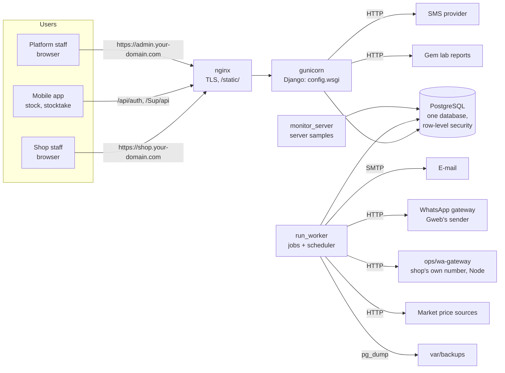
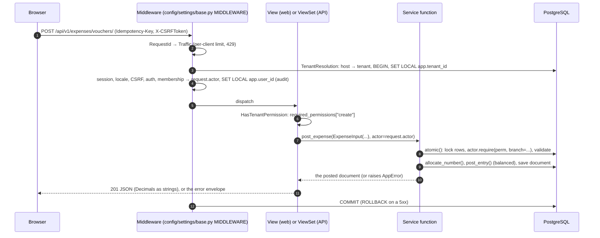
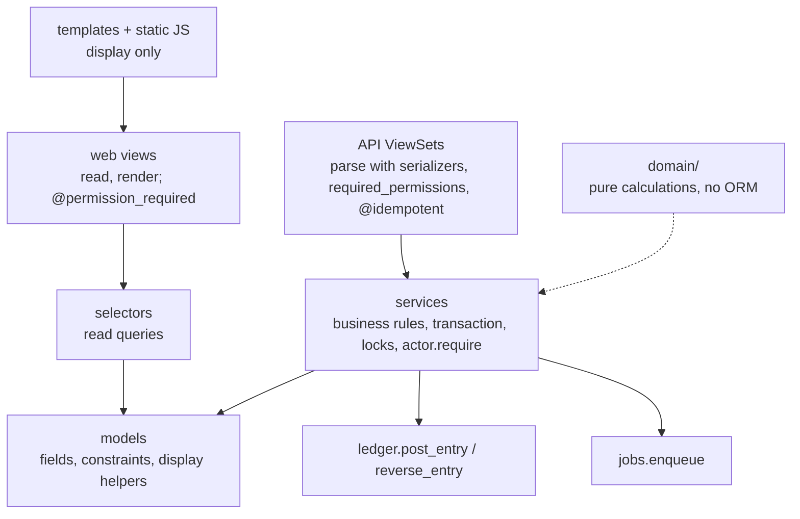

# Architecture overview

What the system is made of and how a request travels through it. For each app's job and the
dependencies between apps, see [modules](modules.md). For the rules new code must follow, see
the [architecture standards](../standards/architecture.md).

Gweb is a multi-tenant ERP for jewellery and gold shops. Each client ("tenant", "workspace") is a
shop with branches. One deployment serves every client, from one Django project and one
PostgreSQL database.

## System context

**Processes** (README "Production"):
- `gunicorn config.wsgi`: web pages and the API.
- `manage.py run_worker`: background jobs and their schedules.
- `manage.py monitor_server`: CPU, memory, disk and Postgres samples.
- Optionally, the Node WhatsApp gateway.

There is no Redis or Celery. The job queue is a PostgreSQL table (`apps/platform/jobs`).

**Two kinds of host.**
- **Tenant hosts** are `<slug>.<TENANT_BASE_DOMAIN>` or a verified custom domain. They serve
  the shop's workspace (`config/urls.py`, `config/api_urls.py`).
- **Platform hosts** (`PLATFORM_HOSTS`) serve the console for platform staff, the Django admin
  at `/django-admin/`, and `/healthz/` (`config/platform_urls.py`). A tenant URL does not exist
  on a platform host, and the reverse is also true.

## Tenant isolation

Isolation is the most important property of the system. It has four layers, and each one is
enforced by tests in `tests/isolation/`:

1. **Host → tenant.** `TenantResolutionMiddleware` (`apps/core/tenancy/middleware.py`) finds the
   tenant from the `Host` header only. Sessions are bound to that tenant, and the membership is
   checked again on every request (`apps/iam/middleware.py`).
2. **Tenant context.** Tenant data is reachable only inside `tenant_context(tenant_id)`
   (`apps/core/tenancy/context.py`). It opens a transaction and runs `SET LOCAL app.tenant_id`.
   Requests, `TenantCommand` management commands and worker jobs provide it; anything else
   raises `TenantContextError`.
3. **Fail-closed ORM.** Every tenant model inherits `TenantScopedModel` (`apps/core/models.py`).
   Its manager filters by the current tenant and raises without one. `save()` stamps and checks
   `tenant_id`.
4. **The database itself.**
   - Every tenant table has `ENABLE` + `FORCE ROW LEVEL SECURITY` with a policy on
     `app.tenant_id` (`apps/core/tenancy/rls.py`, the `EnableTenantRLS` migration operation).
   - A trigger refuses a row whose foreign key points at another tenant's row (`GuardTenantFKs`,
     `apps/audit/triggers.py`). PostgreSQL checks foreign keys without RLS, so this is needed.
   - The application connects as `app_rw`, which cannot bypass RLS. Only backups use
     `app_platform`, which can (`ops/db/bootstrap.sql`).

Platform data (tenants, plans, jobs, monitoring) lives in tables without a tenant column, used
only by `apps/platform` and the host lookup. The console reads a client's data only inside that
client's `tenant_context`.

## A request, start to finish

**Things to know:**
- `ATOMIC_REQUESTS` is off. The middleware's tenant transaction **commits on any response
  below 500**, including 4xx. So a service must open its own `transaction.atomic()` around
  multi-step writes, which the existing services do. An error raised inside that block undoes
  the block.
- Web pages mostly read and render. Writes go through the JSON API: forms with `data-api-form`
  post to it (`static/core/js/forms.js`), and the page shows field errors from the error
  envelope.
- The server does every money calculation. Screens that need a preview ask the API for a quote
  (`quote_sale`, `plan_receipt`) and only display it.

## Layers inside an app

- **Services** are module-level functions taking keyword arguments, often a frozen
  `XInput` dataclass, plus `actor=None`. They hold the business rules (see
  [architecture standards](../standards/architecture.md#where-code-goes)).
- **Models are thin:** fields, constraints, `__str__` and display properties.
- **There are no domain signals.** Signals are used only to record sign-ins.

## Money, gold and documents

- **One ledger for everything** (`apps/ledger`). It is double-entry and multi-commodity: money
  per currency, and gold and silver per metal in fine grams.
  - Every balance anywhere (cash box, customer, stock value) comes from it.
  - `post_entry` refuses an unbalanced entry, and a deferred trigger checks again at COMMIT.
  - Journal tables are append-only in the database: a correction is a reversal.
  - Closed months take no postings.
- **Documents** (`apps.core.models.Document`) carry a number, status, branch and business date.
  - They are edited only as drafts.
  - Posting assigns a gapless number (`apps/core/sequences.py`, row-locked) and applies the
    stock and ledger effects in one transaction.
  - Cancelling (`void_*`) reverses them and is refused once the goods have left stock.
  - Stock movements are append-only like journal lines.
- **Numbers are `Decimal`** and rounded only through `apps/core/numeric.py`. There is no
  `FloatField`, and the API writes Decimals as strings.
- **Karat and fineness conversion** exists only in `apps/catalog/domain/metal.py`.
- **Prices:** a gold piece's price is the day's board price for its karat plus a making charge,
  computed by `apps/pricing/engine.py`. It is never below cost, and discounts stay within a
  personal limit.

## Permissions

- **The permission catalog** is filled by each app's `permissions.py`
  (`register_permissions`, autodiscovered).
- **Roles** are sets of permission codes. A member's role assignment may be limited to some
  branches.
- **`Actor`** (`apps/iam/authz.py`) answers `require(code, branch=...)` and
  `branch_ids(code)`:
  - `None` means all branches.
  - Querysets in views and APIs are filtered with `branch_ids`.
  - Services check again with `require`.
- **Web views** use `@permission_required("code")`. **API views** declare
  `required_permissions` for every action. Undeclared actions are denied, and
  `apps/iam/tests/test_authz.py` fails.
- **HR follows the employee's branch** (`apps.hr.services.visible_employees`). An employee with
  no branch, and a monthly payroll (it pays everyone), need the permission for every branch.
- **Sign-in** is throttled (`apps/iam/throttle.py`). A login used by several workspaces is
  changed only by its owner ([ADR-022](../decisions/ADR-022-identity-across-workspaces.md)).
- **Features** (for example Diamonds) are switched on per client or plan in the console
  (`apps/platform/tenants/features.py`) and are checked like permissions.

## Background work

- **Enqueueing.** A job is a row in `jobs.Job`, written in the same transaction as the work
  that asks for it (the outbox pattern): a rolled-back sale never sends its e-mail.
- **The worker** claims jobs with `FOR UPDATE SKIP LOCKED` and runs each one in its client's
  `tenant_context`, language and time zone. It retries with backoff.
- **Schedules** live in the same worker. `daily()` and `monthly()` run at each client's local
  time; `every()` runs platform tasks every so many minutes.
- **Registration.** Tasks are declared in each app's `jobs.py` with `@task`
  (`apps/platform/jobs/registry.py`). README "Background jobs" lists them.

## External integrations

| What | Where | Notes |
|---|---|---|
| E-mail (documents, reminders) | `apps/messaging`, via jobs | `EMAIL_URL`; development writes to `var/mail` |
| WhatsApp (codes, documents, campaigns) | `apps/messaging/gateways.py` | Gweb's hosted gateway or the shop's own number through `ops/wa-gateway` (Node, Baileys) |
| SMS (one-time codes) | `apps/messaging/codes.py` | any provider taking mobile/message/sender |
| Market gold prices | `apps/platform/market/sources/` | one module per source (Strategy); polled by the worker |
| Gem lab reports (IGI) | `apps/diamonds/igi.py` | public PDF plus optional API key |
| PDFs | `apps/printing/pdf.py` | headless Chromium (Playwright); JavaScript off, outside requests blocked |

## Frontend

- Server-rendered Django templates, with Tailwind v4 built into the committed
  `static/core/css/app.css`.
- Vanilla ES modules with no bundler: one module per page, plus shared helpers in
  `static/core/js/`.
- Arabic (RTL) and English.
- README "Frontend assets" covers the design tokens. The JS conventions are in the
  [architecture standards](../standards/architecture.md#frontend).

## Glossary

Words a new developer won't guess:

| Word in the code | Means |
|---|---|
| tenant, workspace, client | one shop (customer of the platform) |
| platform, console | Gweb's own staff side, on platform hosts |
| `trade` (`apps/sales/trade.py`) | wholesale to trade accounts (dealers), by weight |
| `holders` (`apps/treasury/holders.py`) | where money is held: cash boxes, bank accounts, card terminals |
| tender | how something is paid: cash, card, bank transfer, on account |
| `settlements` | receipts and payments with customers, suppliers, traders, workshops |
| fine grams, fineness | pure-metal weight; 21K = 875‰ |
| making charge | the price of the work on a piece, per gram, on top of the gold |
| scrap | old gold bought by weight, at the scrap price less a loss |
| board (price board) | the day's metal prices per karat |
| void / cancel / undo | all mean "reverse a posted document" (`DocStatus.VOIDED` is labelled "Cancelled") |
| `catalog` vs `catalogue` | `apps/catalog` = currencies, metals, karats, categories; `inventory/catalogue.py` = the photo catalogue; `iam/catalog.py` = the permission catalog |
| `documents` | `core/documents.py` = links to any document; `printing/documents.py` = printable document types; `inventory/api/documents.py` = stock document API |
| `statements` | `ledger/statements.py` = party/holder statements; `reports/statements.py` = P&L and balance sheet |
| `diamonds/jobs.py` | stone-setting work (setter jobs), not background jobs |
| § numbers in comments | sections of `PROJECT_PLAN.md`, the design document |

## Known limitations

See the [technical debt register](../tech-debt.md). The ones that shape the architecture:
- Dependency cycles between apps (TD-08).
- Duplicated cancel and payment flows (TD-09).
- No service layer in the console (TD-11).
